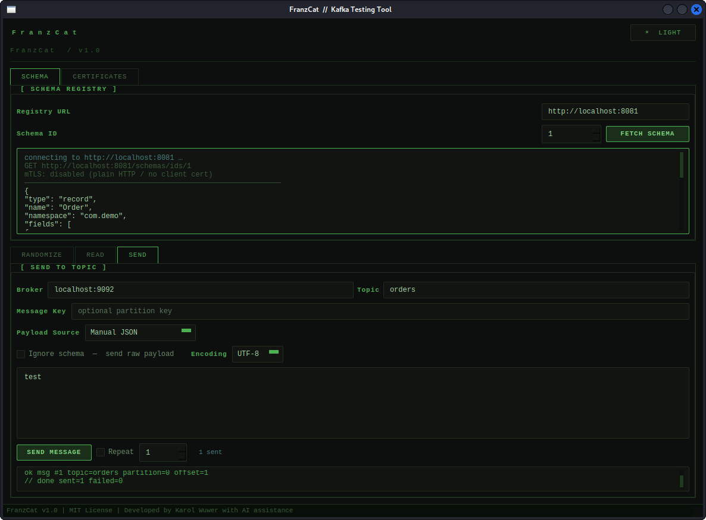
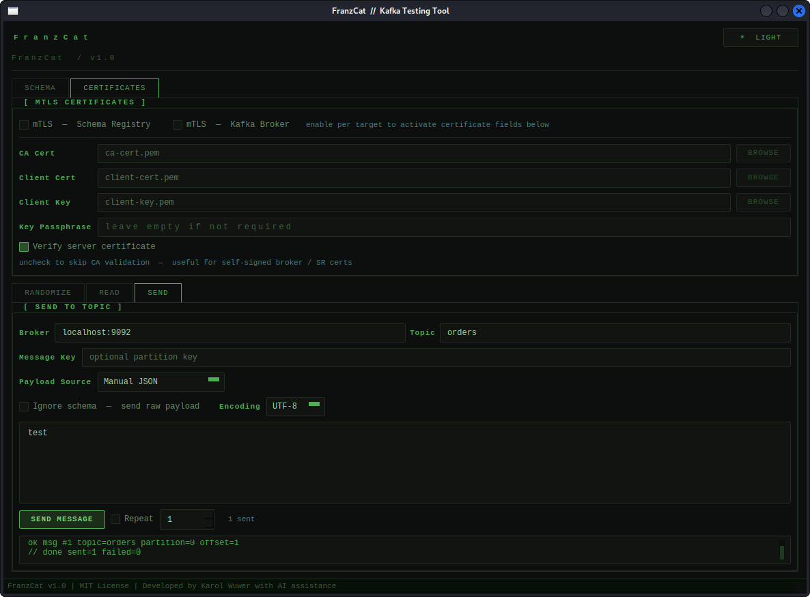
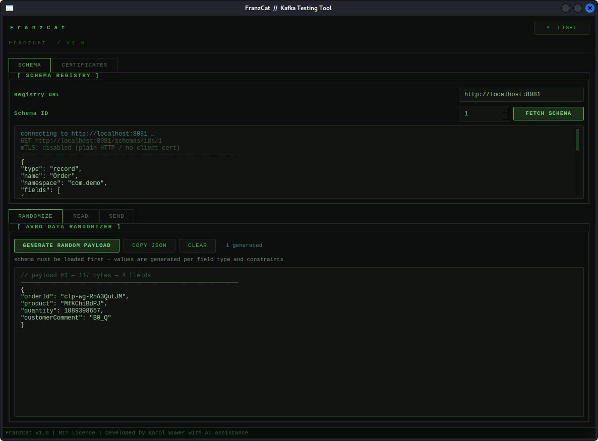
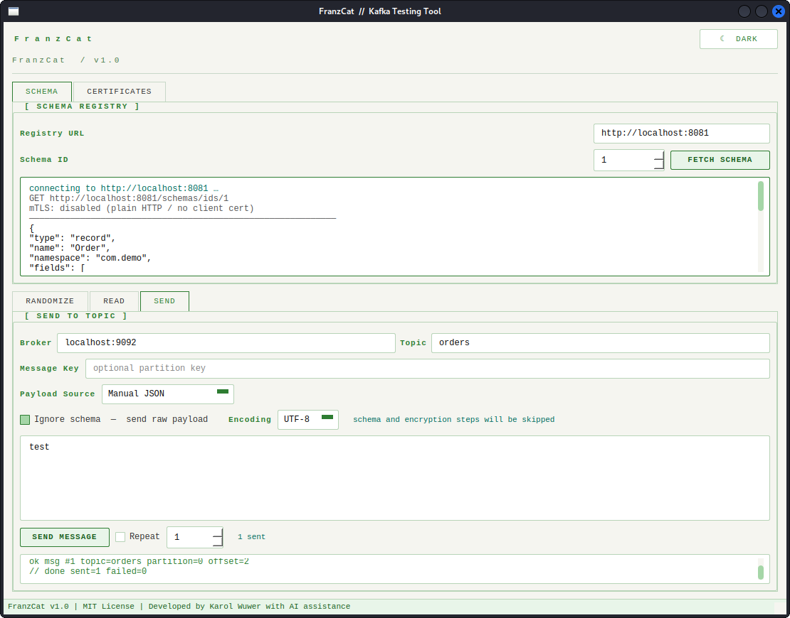

# 🐱 FranzCat

[](https://opensource.org/licenses/MIT)  

  

Kafka testing tool for developers, QA engineers, SREs, platform engineers, and security testers.

FranzCat provides a desktop interface for interacting with Kafka brokers and Confluent Schema Registry. It supports Avro schemas, payload generation, Kafka topics read and write operations, and mTLS connectivity.

See the [Changelog](CHANGELOG.md) for recent changes.

---

# Installation

## Requirements
 - Python 3.10 or newer
 - Network access to a Kafka broker (and optionally a Confluent Schema Registry)

## Setup

1. Clone the repository:

   ```bash
   git clone https://github.com/s0shell/franzcat.git
   cd franzcat
   ```

2. Create and activate a virtual environment (recommended):

   ```bash
   python3 -m venv .venv
   source .venv/bin/activate        # Windows: .venv\Scripts\activate
   ```

3. Install the dependencies:

   ```bash
   pip install -r requirements.txt
   ```

4. Run the application:

   ```bash
   python main.py
   ```

## Dependencies

| Package | Purpose |
|---|---|
| PyQt6 | Desktop UI |
| confluent-kafka | Kafka producer/consumer |
| fastavro | Avro schema parsing and payload encoding |
| requests, urllib3 | Schema Registry (HTTP/mTLS) communication |

## Settings

Form values (URLs, brokers, topics, certificate paths, checkboxes, theme, window size) are saved automatically to `settings.json` in the per-user config directory and restored on the next start:

The location is the OS-standard application config directory (Qt `AppConfigLocation`), for example `~/Library/Preferences/FranzCat/FranzCat/settings.json` on macOS. Linux and Windows use their respective standard config directories (typically under `~/.config` and `%LOCALAPPDATA%`).

Set the `FRANZCAT_CONFIG` environment variable to use a different file. The key passphrase and message payloads are intentionally **not** stored.

---

# Features

## Schema Registry
 - Load schema by ID
 - Schema preview
 - Supports (m)TLS connections

## Paload Generation
 - Avro payload randomizer
 - Automatic generation based on loaded schema

## Topic Reading
 - Read from earliest/specific/latest offset
 - Message navigation
 - Raw payload inspection
 - Hex / Base64 view

## Topic Writing
 - Publish generated payloads
 - Manual JSON publishing
 - Raw payload mode

## Security
 - (m)TLS support
 - CA verification controls

 ---
 # Screenshots

 
 
 
 